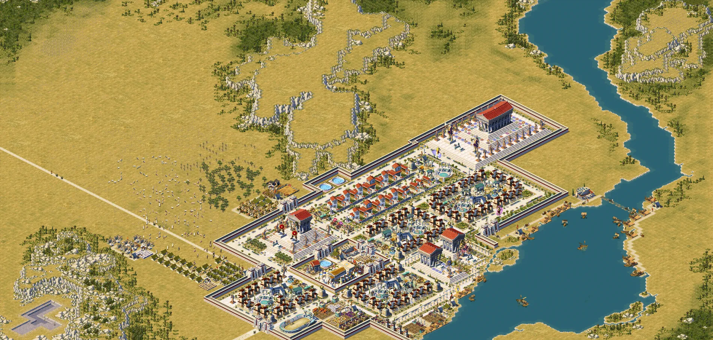
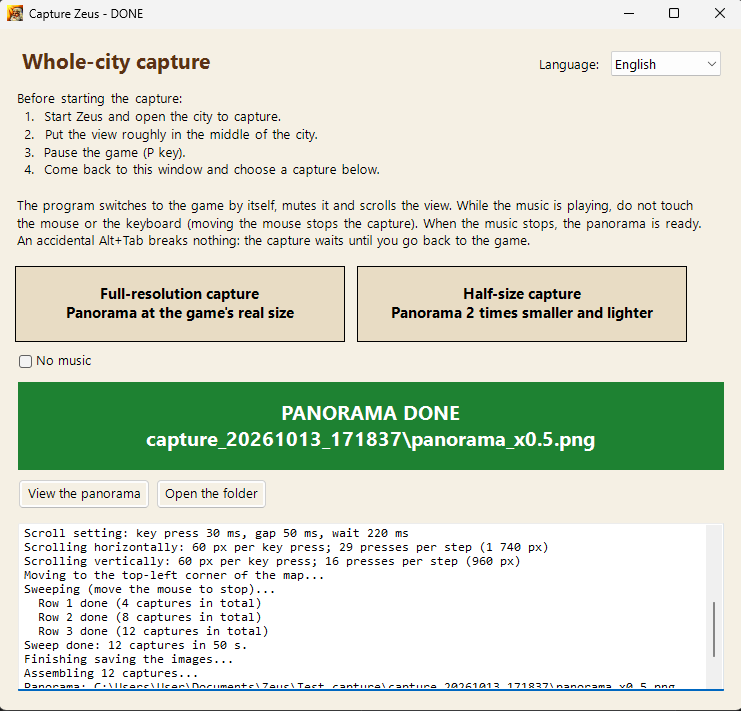
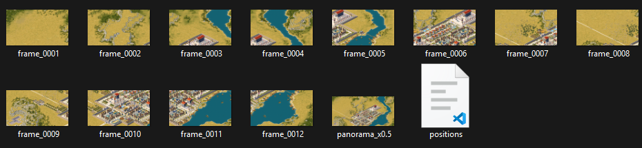

# Capture Zeus

**Whole-city panorama for *Zeus: Master of Olympus* (and *Poseidon*)**
· [Version française plus bas](#français)

The game only shows part of your city at a time. Capture Zeus scrolls the view by itself, takes a screenshot at every step, aligns them precisely and stitches everything into **one big PNG picture of the whole city**.

## Download

Get the latest zip from the **[Releases](../../releases)** page, unzip it anywhere you can write (not in *Program Files*) and run `Capture Zeus.exe`. Nothing to install.

> Windows may show *"Windows protected your PC"* the first time, because the program is new and unsigned: click **More info**, then **Run anyway**.

## How to use

1. Start Zeus, open the city to capture, put the view roughly in the middle of the city and **pause the game** (P key).
2. Run `Capture Zeus.exe` and click **Full-resolution capture** or **Half-size capture**.
3. The banner turns red: **don't touch the mouse or the keyboard** while the music plays. The program switches to the game by itself, mutes it and scrolls the view.
4. When the music stops, the panorama is ready (green banner): click **View the panorama**.

Each capture creates a `capture_YYYYMMDD_HHMMSS` folder next to the exe, with `panorama.png` (or `panorama_x0.5.png`), the individual screenshots `frame_*.png` and `positions.csv`.

- Moving the mouse stops the capture (that is the way to interrupt it).
- An accidental Alt+Tab breaks nothing: the capture pauses and resumes when you go back to the game.
- The interface is in English and French (*Language* list, top right).
- The working music is a short melody generated by the program. To use your own, put any `.wav` file next to the exe (`music.wav` is chosen first if there are several).

## Requirements

- Zeus: Master of Olympus, with or without Poseidon, at any resolution (tested at 1024×768, 1080p and 1440p).
- Windows 7 to 11 with .NET Framework 4 (already part of Windows 10 and 11).

## Antivirus

Capture Zeus simulates arrow key presses, switches windows and takes screenshots: that is exactly its job, but a few automatic antivirus engines may call it "suspicious". It never connects to the Internet and only writes into its own `capture_...` folders. The full source code is in this repository.

## Building

Run `build.cmd`: it uses the C# compiler that ships with Windows (.NET Framework 4) and produces `dist\Capture Zeus.exe`. `tools\make_release.ps1` builds the release zip. No other tool is needed.

| File | Role |
|---|---|
| `src/CaptureApp.cs` | capture run: game window, scrolling, pause on Alt+Tab, command line |
| `src/CaptureForm.cs` | main window |
| `src/ZeusCapture.cs` | screen capture, image alignment, panorama assembly |
| `src/Signal.cs` | working music, banner, taskbar flash |
| `src/GameAudio.cs` | mutes only the game (Windows Core Audio) |
| `src/Lang.cs` | English / French |

Advanced command line: `"Capture Zeus.exe" test`, `"Capture Zeus.exe" assembler <folder> [scale]`, options `--delai <seconds>`, `--silencieux` (no music), `--lent` (careful scrolling).

## License

MIT, see [LICENSE](LICENSE). This is a fan project, not affiliated with Impressions Games, Sierra or Activision. *Zeus: Master of Olympus* and *Poseidon* are trademarks of their respective owners; no game file is included.

---

## Français

**Panorama de la cité entière pour *Le Maître de l'Olympe : Zeus* (et *Poséidon*)**

Le jeu ne montre qu'une partie de la cité à la fois. Capture Zeus fait défiler la vue tout seul, prend une capture d'écran à chaque pas, les recale précisément et assemble le tout en **une seule grande image PNG de la cité entière**.

### Téléchargement

Prenez le dernier zip sur la page **[Releases](../../releases)**, décompressez-le dans un dossier où vous pouvez écrire (pas dans *Program Files*) et lancez `Capture Zeus.exe`. Rien à installer.

> Au premier lancement, Windows peut afficher *« Windows a protégé votre ordinateur »*, car le programme est récent et non signé : cliquez sur **Informations complémentaires**, puis **Exécuter quand même**.

### Utilisation

1. Lancez Zeus, ouvrez la cité à capturer, placez la vue à peu près au milieu de la ville et **mettez la partie en pause** (touche P).
2. Lancez `Capture Zeus.exe` et cliquez sur **Capture pleine résolution** ou **Capture réduite de moitié**.
3. Le bandeau devient rouge : **ne touchez ni à la souris ni au clavier** tant que la musique joue. Le programme passe tout seul sur le jeu, lui coupe le son et fait défiler la vue.
4. Quand la musique s'arrête, le panorama est prêt (bandeau vert) : cliquez sur **Voir le panorama**.

Chaque capture crée un dossier `capture_AAAAMMJJ_HHMMSS` à côté de l'exe, avec `panorama.png` (ou `panorama_x0.5.png`), les captures une par une `frame_*.png` et `positions.csv`.

- Bouger la souris arrête la capture (c'est le moyen de l'interrompre).
- Un Alt+Tab par erreur ne casse rien : la capture se met en pause et reprend quand vous revenez dans le jeu.
- L'interface est en français et en anglais (liste *Langue*, en haut à droite).
- La musique de travail est une petite mélodie générée par le programme. Pour utiliser la vôtre, placez un fichier `.wav` à côté de l'exe (`music.wav` est choisi en priorité s'il y en a plusieurs).

### Prérequis

- Le Maître de l'Olympe, avec ou sans Poséidon, à toutes les résolutions (testé en 1024×768, 1080p et 1440p).
- Windows 7 à 11 avec .NET Framework 4 (déjà présent sur Windows 10 et 11).

### Antivirus

Capture Zeus simule des appuis sur les flèches, change de fenêtre et prend des captures d'écran : c'est exactement son travail, mais quelques antivirus automatiques peuvent le juger « suspect ». Il ne se connecte jamais à Internet et n'écrit que dans ses propres dossiers `capture_...`. Tout le code source est dans ce dépôt.

### Compilation

Lancez `build.cmd` : il utilise le compilateur C# fourni avec Windows (.NET Framework 4) et produit `dist\Capture Zeus.exe`. `tools\make_release.ps1` prépare le zip de la release. Aucun autre outil n'est nécessaire.

### Licence

MIT, voir [LICENSE](LICENSE). Projet de fan, sans lien avec Impressions Games, Sierra ou Activision. *Le Maître de l'Olympe : Zeus* et *Poséidon* sont des marques de leurs propriétaires respectifs ; aucun fichier du jeu n'est inclus.
